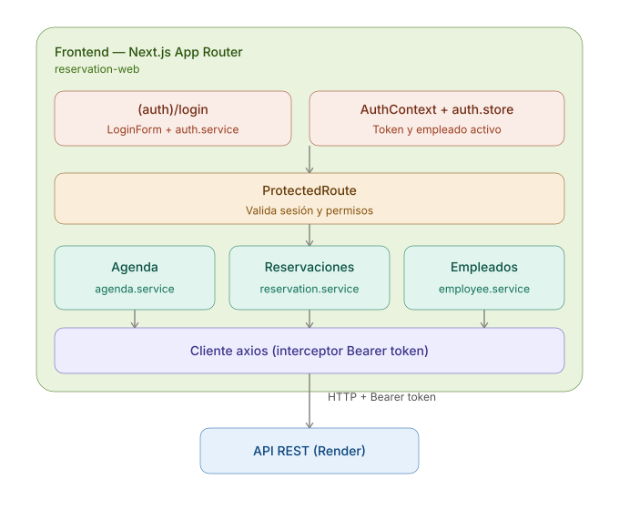
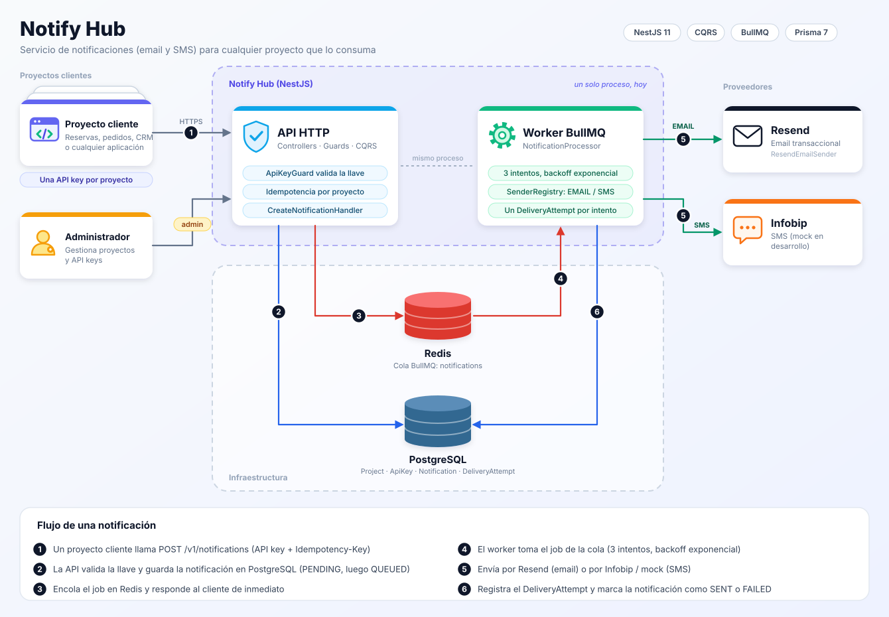
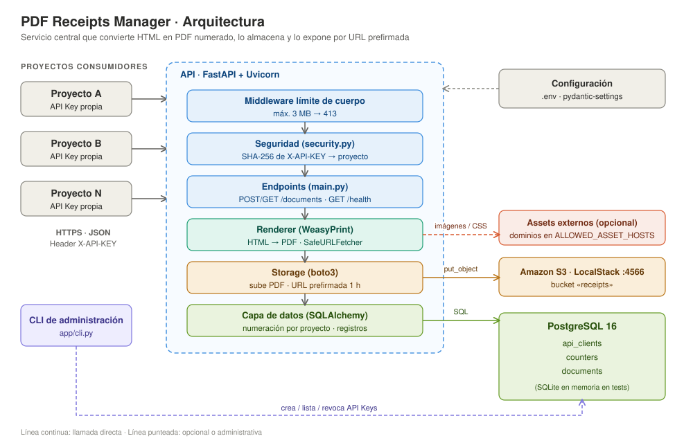

<div align="center">


<a href="https://github.com/Kvilleda089">
  
</a>

</div>

<br/>

## 👋 Sobre mí

Soy **Kevin Villeda**, Ingeniero en Sistemas y desarrollador full stack, con 4 años como desarrollador. Me gusta construir proyectos propios donde pueda recorrer todo el ciclo de vida del software: desde el análisis y diseño, pasando por el desarrollo, hasta las pruebas y el despliegue.

- 🎓 Ingeniero en Sistemas y Ciencias de la Comunicación — Universidad Mariano Gálvez
- 🎓 Maestría en Informática — Universidad Mariano Gálvez
- 🌱 Aprendiendo constantemente y mejorando con cada proyecto que construyo
- 📫 Contáctame: **struj3884@gmail.com**

<br/>

## 🧰 Stack tecnológico

<div align="center">


</div>

<br/>

<table align="center">
<tr>
<td valign="top" width="50%">

**Frontend**
```
React · Angular · TypeScript
JavaScript · React Native · Bootstrap
```

**Backend**
```
Java (Spring Boot, MicroProfile)
NestJS / Node.js · Python (FastAPI) · C#
```

</td>
<td valign="top" width="50%">

**Bases de datos**
```
PostgreSQL · MariaDB · MySQL
Oracle · MongoDB · Redis
```

**Herramientas & prácticas**
```
Docker · Microservicios · Kafka · BullMQ
AWS S3 · GIT · SCRUM · UML/C4 · JUnit
UiPath (RPA) · Creatio (BPM)
```

</td>
</tr>
</table>

<br/>

## 🚀 Proyectos destacados

<table align="center">
<tr>
<td width="100%">

### 🏟️ Sistema de Reservas de Canchas y Salones

Plataforma para gestionar reservas de dos canchas deportivas y salones de eventos. La pantalla principal muestra el listado de reservaciones con filtros por cliente, hora, fecha y estado.

Backend desplegado en Render · Base de datos en Neon (PostgreSQL)


<br/><br/>

<a href="https://github.com/Kvilleda089/api-reservation">
  
</a>

<br/><br/>

#### 🔧 Despliegue y flujo de trabajo

El proyecto se despliega en **Render** a partir de un `Dockerfile`, con dos ramas conectadas a sus propios servicios (`quality-assurance` para pruebas y `master` para producción), compartiendo una base de datos en **Neon**.

<p align="center">
  
  &nbsp;
  
</p>

<p align="center">
  <sub><b>Izquierda:</b> configuración del despliegue en Render · <b>Derecha:</b> flujo de ramas de GitHub hacia Render y Neon</sub>
</p>

<br/>

#### 🖥️ Frontend — ReservaFácil (reservation-web)

Interfaz web construida con **Next.js (App Router)**, organizada por features (agenda, auth, dashboard, employee, statistics, client). Maneja el login y la sesión del empleado con `AuthContext`, y protege las rutas según el rol (`COURT_MANAGER`, `ADMINISTRATOR`, `SUPER_ADMINISTRATOR`) con un componente de ruta protegida. Se comunica con la API mediante un cliente Axios con interceptor que agrega el token automáticamente.


<br/><br/>

<a href="https://github.com/Kvilleda089/reservation-web">
  
</a>

<br/><br/>

<p align="center">
  
</p>

<p align="center">
  <sub>Arquitectura del frontend: organización por features, autenticación y rutas protegidas</sub>
</p>

</td>
</tr>
</table>

<br/>

## 🧩 Servicios reutilizables

Microservicios independientes del sistema de reservas. Cada uno se consume por **HTTP con API key**, así que cualquier otro proyecto (incluido el de reservas) puede integrarlos sin tocar su código.

<table align="center">
<tr>
<td width="100%">

### 🔔 Notify Hub

Microservicio de notificaciones por **email y SMS**. Recibe la solicitud por HTTP, la guarda en base de datos, la encola y la envía en segundo plano con reintentos automáticos. Es **multi-tenant**: cada aplicación cliente es un *Project* con sus propias API keys.

- **Idempotencia** con `Idempotency-Key`: reenviar la misma petición no duplica el mensaje.
- **Envío asíncrono** con BullMQ + Redis: 3 intentos con backoff exponencial.
- **Historial de intentos** (`DeliveryAttempt`) con proveedor, estado y error de cada envío.
- **Reenvío manual** de notificaciones enviadas o fallidas.
- **Proveedores intercambiables**: Resend (email) e Infobip o *mock* (SMS); agregar uno nuevo no toca el resto del código.
- Autenticación por **API key** (clientes) y **token de administrador** (gestión de proyectos).


<br/><br/>

<a href="https://github.com/Kvilleda089/notify-hub">
  
</a>

<br/><br/>

#### 📐 Diagramas


<p align="center">
  
</p>
<p align="center">
  <sub>Arquitectura: API, cola con Redis, worker y proveedores de envío</sub>
</p>


<!-- PENDIENTE DIAGRAMA DESPLIEGUES-->

</td>
</tr>
</table>

<br/>

<table align="center">
<tr>
<td width="100%">

### 🧾 PDF Receipts Manager

Servicio centralizado que **convierte HTML en PDF**, le asigna un **número correlativo por proyecto**, lo guarda en **S3** y registra sus metadatos en **PostgreSQL**. Los proyectos consumidores envían el HTML ya armado y reciben el número de documento y una URL prefirmada para descargar el PDF.

- Generación de PDF desde HTML con **WeasyPrint**.
- Numeración independiente por proyecto (`PREFIJO-000001`, `PREFIJO-000002`, …).
- Almacenamiento en **S3** (LocalStack en desarrollo) con URLs prefirmadas de 1 hora.
- Autenticación por **API Key**; en base de datos solo se guarda el hash SHA-256.
- **Aislamiento por proyecto**: un proyecto no puede consultar documentos de otro.
- **Protección contra SSRF**: el HTML solo carga recursos `data:` o de dominios autorizados.
- **CLI** para crear, listar y revocar API Keys.


<br/><br/>

<a href="https://github.com/Kvilleda089/pdf-receipts-manager">
  
</a>

<br/><br/>

#### 📐 Diagramas

<p align="center">
  
</p>
<p align="center">
  <sub>Arquitectura: API, renderer, storage en S3 y base de datos</sub>
</p>
<!-- ESPACIO PARA DESPLIEGUE — PDF Receipts Manager (se integra más adelante) -->

</td>
</tr>
</table>

<br/>

## 📊 Estadísticas

<div align="center">


<br/><br/>


</div>

<br/>

## 📬 Contacto

<div align="center">

<a href="https://www.linkedin.com/in/kevin-trujillo-2222521a8/">
  
</a>
<a href="mailto:struj3884@gmail.com">
  
</a>

</div>

<br/>

<div align="center">


</div>
